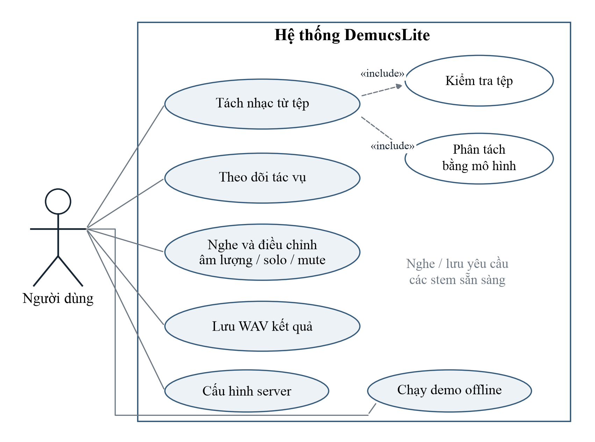
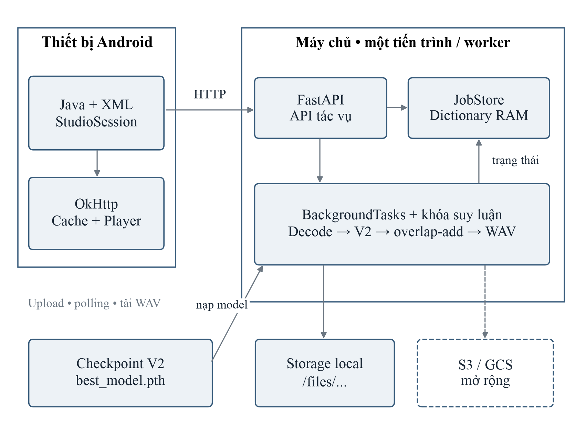
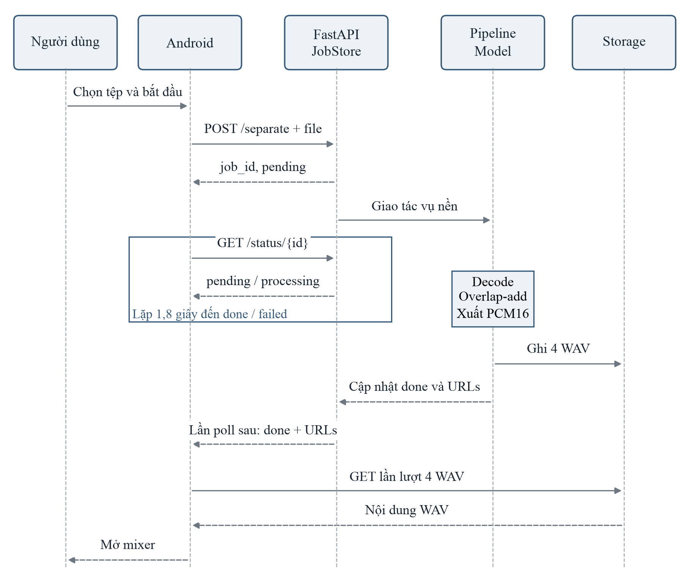
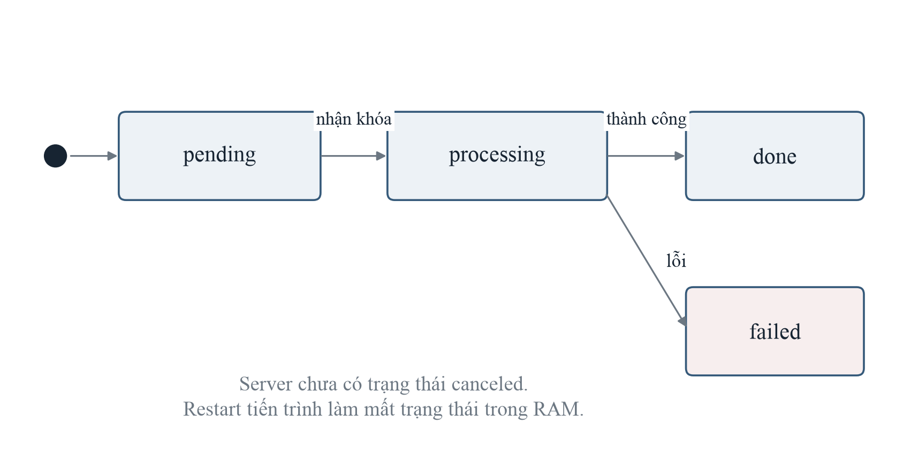
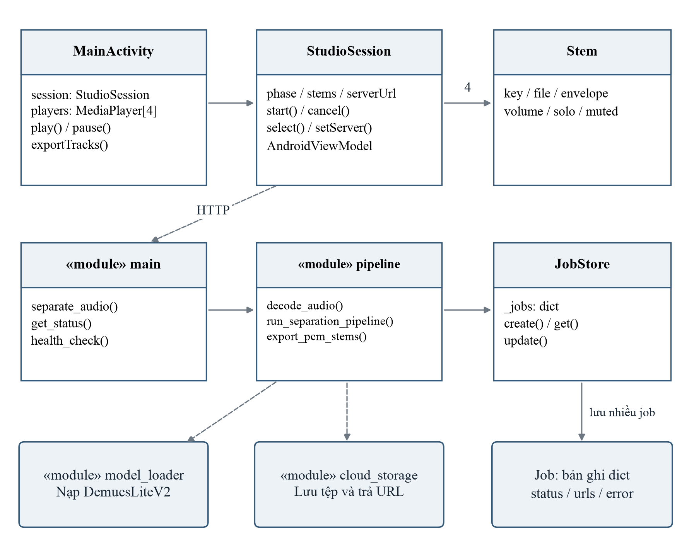
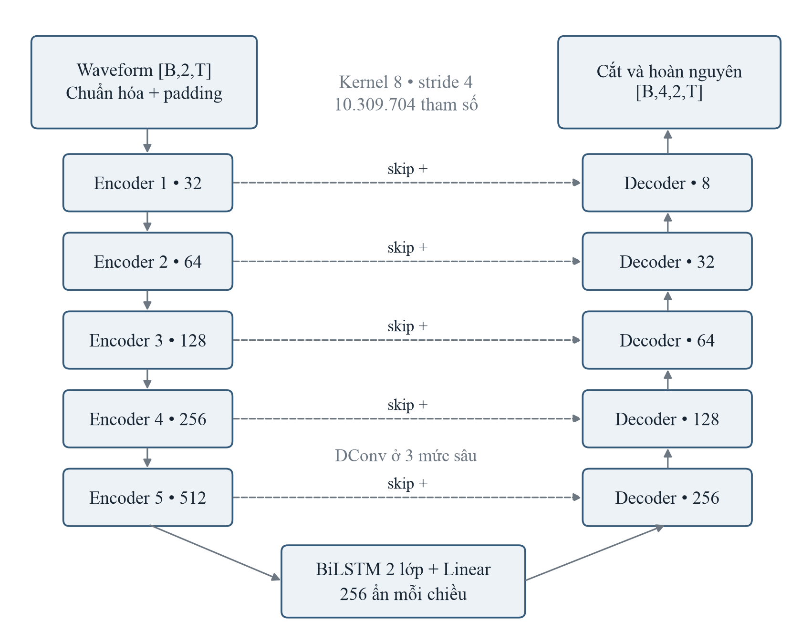
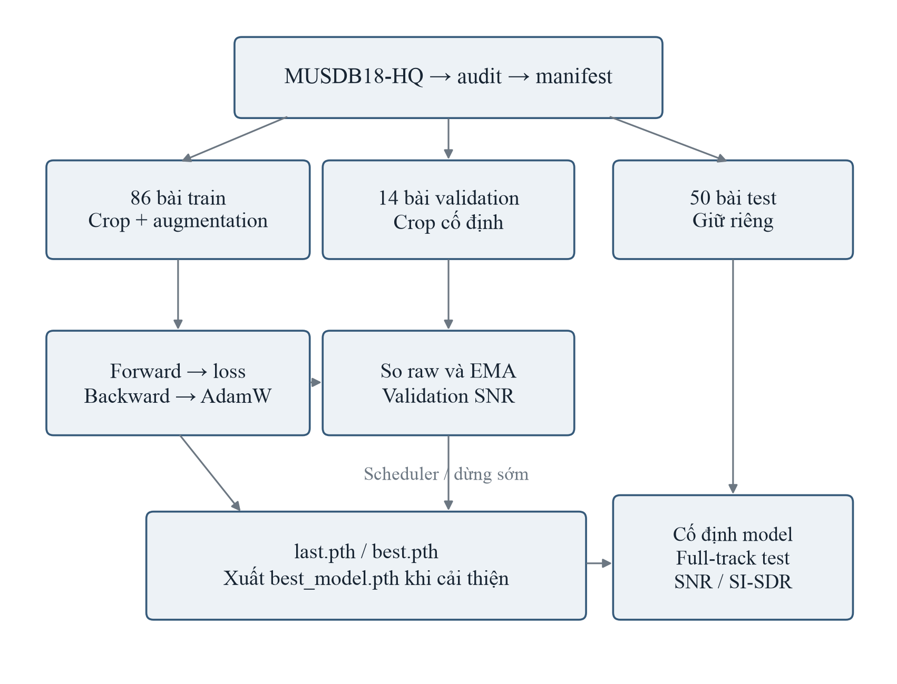
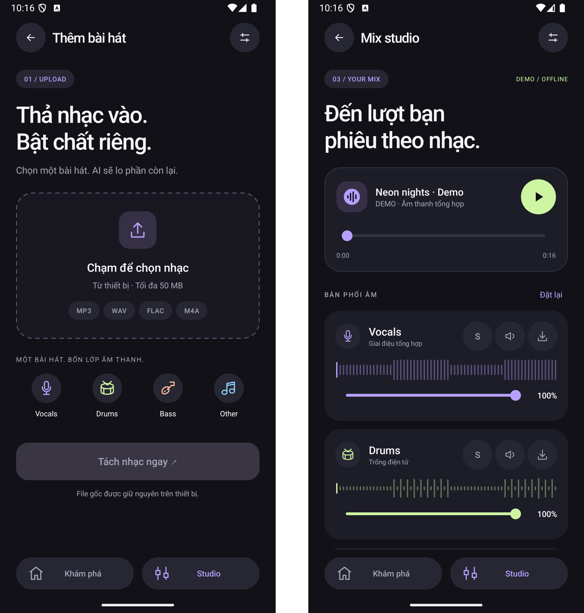
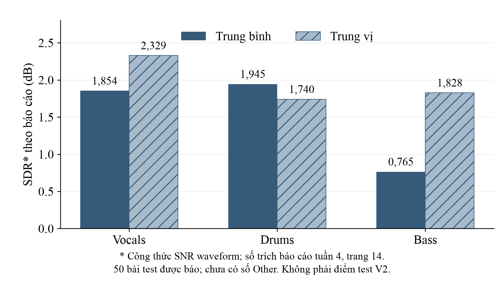
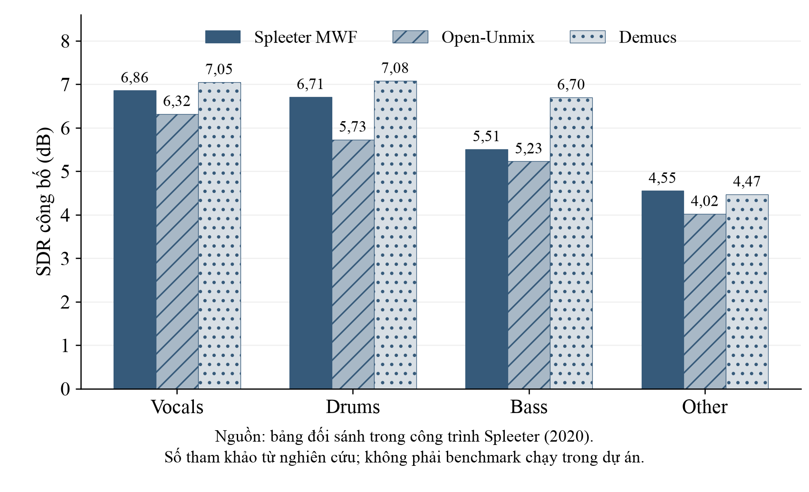

# Xây dựng ứng dụng Android tách nguồn âm nhạc bằng mô hình DemucsLite

## Mục lục

- [CHƯƠNG 1 MỞ ĐẦU](#chương-1-mở-đầu)
- [CHƯƠNG 2 CƠ SỞ LÝ THUYẾT VÀ CÁC NGHIÊN CỨU LIÊN QUAN](#chương-2-cơ-sở-lý-thuyết-và-các-nghiên-cứu-liên-quan)
- [CHƯƠNG 3 KIẾN TRÚC HỆ THỐNG VÀ GIẢI PHÁP KỸ THUẬT](#chương-3-kiến-trúc-hệ-thống-và-giải-pháp-kỹ-thuật)
- [CHƯƠNG 4 KẾT QUẢ THỰC NGHIỆM VÀ ĐÁNH GIÁ](#chương-4-kết-quả-thực-nghiệm-và-đánh-giá)
- [KẾT LUẬN VÀ HƯỚNG PHÁT TRIỂN](#kết-luận-và-hướng-phát-triển)
- [TÀI LIỆU THAM KHẢO](#tài-liệu-tham-khảo)
- [PHỤ LỤC A TRUY VẾT SỐ LIỆU VÀ CHECKPOINT](#phụ-lục-a-truy-vết-số-liệu-và-checkpoint)
- [PHỤ LỤC B HƯỚNG DẪN SỬ DỤNG VÀ TÁI LẬP](#phụ-lục-b-hướng-dẫn-sử-dụng-và-tái-lập)

## Tóm tắt

Đề tài xây dựng hệ thống tách một bản nhạc stereo thành bốn nguồn gồm giọng hát, trống, bass và các thành phần còn lại. Hệ thống kết hợp ứng dụng Android với dịch vụ FastAPI và mô hình DemucsLite V2 xử lý trực tiếp waveform. Người dùng chọn tệp, gửi yêu cầu tách nhạc, theo dõi trạng thái, nghe từng nguồn và lưu các tệp WAV. Kiến trúc client–server chuyển phần suy luận học sâu sang máy chủ, trong khi điện thoại đảm nhiệm tương tác, tải kết quả và điều khiển phát nhạc.

Mô hình triển khai có 10.309.704 tham số, gồm năm tầng encoder, bottleneck BiLSTM hai lớp và năm tầng decoder. Checkpoint export tại epoch 100 sử dụng trọng số EMA và ghi nhận validation SNR tốt nhất là 3,539065 dB. Kết quả này xác nhận một mốc lựa chọn mô hình trên validation, chưa đại diện cho chất lượng trên tập test. Bảng thực nghiệm giai đoạn trước ghi nhận kết quả riêng cho Vocals, Drums và Bass trên 50 bài test; các số liệu được trình bày theo đúng phạm vi và định nghĩa của phép đo.

Báo cáo trình bày cơ sở lý thuyết, nghiên cứu liên quan, yêu cầu phần mềm, kiến trúc hệ thống, quy trình huấn luyện và suy luận, cùng kết quả kiểm chứng hiện có. Đóng góp chính là một nguyên mẫu hoàn chỉnh từ mô hình đến ứng dụng. Những nội dung cần tiếp tục đánh giá gồm benchmark thống nhất cho V2, độ đồng bộ phát nhiều nguồn, thời gian xử lý đầu cuối và triển khai lưu trữ đám mây.

Từ khóa: tách nguồn âm nhạc, DemucsLite, U-Net 1D, BiLSTM, Android, FastAPI, MUSDB18-HQ.

<!-- BODY_START -->

# CHƯƠNG 1 MỞ ĐẦU

## 1.1 Bối cảnh và lý do chọn đề tài

Một bản nhạc hoàn chỉnh thường là tổng hợp của nhiều thành phần được ghi âm, xử lý và phối trộn. Khi chỉ có tệp nhạc cuối cùng, người nghe không thể điều chỉnh độc lập giọng hát, trống hoặc bass như khi có các bản thu gốc. Nhu cầu nghe riêng từng thành phần xuất hiện trong luyện hát, luyện nhạc cụ, phân tích hòa âm và chuẩn bị nội dung phối nhạc. Tách nguồn âm nhạc nhằm ước lượng lại các thành phần này từ tín hiệu hỗn hợp.

Bài toán khó vì nhiều nguồn cùng hoạt động trong một khoảng thời gian và có dải tần chồng lấn. Một bộ lọc tần số đơn giản có thể làm mất cả tiếng hát lẫn nhạc cụ nằm trong cùng dải. Các kỹ thuật học sâu khai thác cấu trúc phổ và diễn biến theo thời gian để dự đoán nguồn, nhưng kết quả vẫn có thể bị rò âm, mất chi tiết hoặc xuất hiện âm thanh méo. Vì vậy, xây dựng ứng dụng cần gắn chất lượng mô hình với cách xử lý dữ liệu, giao thức giao tiếp và trải nghiệm sử dụng.

Đề tài chọn hướng triển khai một mô hình waveform có quy mô xác định, kết hợp giao diện Android và dịch vụ suy luận trên máy chủ. Cách tổ chức này cho phép thay checkpoint mà không phải đưa toàn bộ mô hình vào điện thoại. Đồng thời, người dùng có thể tiếp cận chức năng tách nhạc thông qua một luồng thao tác ngắn, thay vì phải chạy notebook hoặc lệnh Python.

## 1.2 Mục tiêu và câu hỏi nghiên cứu

Mục tiêu tổng quát là xây dựng và đánh giá nguyên mẫu ứng dụng Android tách bốn nguồn âm nhạc bằng DemucsLite. Mục tiêu kỹ thuật gồm chuẩn bị dữ liệu có kiểm tra tính nhất quán, hiện thực mô hình encoder–decoder, tổ chức huấn luyện có lưu và phục hồi checkpoint, cung cấp API xử lý nền, và hoàn thiện các thao tác nghe, điều chỉnh âm lượng, lưu kết quả trên điện thoại.

Đề tài tập trung trả lời ba câu hỏi. Thứ nhất, một mô hình U-Net 1D kết hợp BiLSTM có thể được tích hợp thành luồng xử lý tệp hoàn chỉnh như thế nào? Thứ hai, chất lượng phân tách thay đổi ra sao giữa các nguồn, và phép đo nào đủ rõ ràng để diễn giải kết quả? Thứ ba, các giới hạn của nguyên mẫu nằm ở mô hình, tài nguyên máy chủ hay cách tổ chức ứng dụng?

Tiêu chí hoàn thành phần ứng dụng là nhận đúng tệp hợp lệ, trả mã tác vụ, xử lý và xuất đủ bốn nguồn, thông báo được lỗi, cho phép nghe và lưu WAV. Tiêu chí đánh giá mô hình là báo cáo đúng metric, đúng tập dữ liệu và đúng checkpoint. Các mục tiêu về tốc độ hoặc chất lượng vượt mô hình khác chỉ được xác nhận khi có phép đo chung, có thể truy vết.

## 1.3 Đối tượng và phạm vi

Đối tượng nghiên cứu là âm nhạc stereo, mô hình tách nguồn có giám sát và hệ thống phân phối kết quả qua API. Bốn nhóm nguồn cố định là vocals, drums, bass và other. Other gom những thành phần ngoài ba nhóm còn lại; hệ thống không định danh riêng từng loại nhạc cụ trong nhóm này.

Dữ liệu nghiên cứu là MUSDB18-HQ. Mô hình được thực thi bằng PyTorch ở phía máy chủ. Client hiện tại là Android native viết bằng Java và XML, hỗ trợ từ API 29 theo cấu hình dự án. Đầu vào ứng dụng gồm WAV, MP3, FLAC và M4A trong giới hạn dung lượng cấu hình; khả năng xử lý thực tế còn phụ thuộc bộ giải mã và nội dung tệp. Đầu ra phục vụ ứng dụng là bốn WAV stereo 44,1 kHz, PCM 16-bit.

Phạm vi hiện tại là xử lý tệp, không phải tách âm trực tiếp từ micro trong thời gian thực. Chức năng mixer điều chỉnh cách nghe các stem; việc lưu kết quả sao chép WAV đã tách, chưa tổng hợp một tệp phối mới theo các slider. Hệ thống cũng chưa có tài khoản người dùng, lịch sử dự án lưu bền vững hoặc giao diện quản trị. Các giới hạn này giúp xác định đúng phạm vi nghiệm thu của sản phẩm.

## 1.4 Phương pháp thực hiện

Quy trình nghiên cứu kết hợp khảo sát tài liệu, xây dựng mô hình, phát triển phần mềm và phân tích thực nghiệm. Tài liệu về U-Net, Demucs, Hybrid Demucs và Hybrid Transformer Demucs được dùng để xác định lựa chọn kiến trúc. Dữ liệu được tổ chức theo bài hát trước khi lấy crop nhằm giữ ranh giới giữa train, validation và test. Mã nguồn tách riêng các thành phần dữ liệu, loss, metric, huấn luyện, suy luận và dịch vụ API.

Phần đánh giá phân biệt ba loại bằng chứng: kết quả đã ghi trong báo cáo tiến độ, thông tin trực tiếp từ checkpoint và mã nguồn hiện hành, và kiểm thử chức năng bằng dữ liệu tổng hợp. Chúng trả lời những câu hỏi khác nhau. Một kiểm thử API thành công chứng minh khả năng vận hành của luồng xử lý, nhưng không chứng minh giọng hát đã được tách sạch. Ngược lại, một điểm SNR không chứng minh ứng dụng phục hồi được sau lỗi mạng.

## 1.5 Quá trình phát triển và đóng góp

Bảng 1.1 Tổng hợp các giai đoạn phát triển

| Giai đoạn | Nội dung chính | Kết quả và phạm vi |
| --- | --- | --- |
| Tuần 1 | Khảo sát kiến trúc và luồng client–server | Đề xuất hướng tối giản; các thông số kỳ vọng chưa phải kết quả đo |
| Tuần 2 | Chuẩn hóa và tổ chức dữ liệu | Báo cáo ghi nhận 150 bài, 750 WAV đúng chuẩn |
| Tuần 3 | Hiện thực mô hình và training loop | U-Net 1D, BiLSTM, bốn nguồn; split ban đầu 85/15 |
| Tuần 4 | Đánh giá chất lượng và tốc độ | Bảng ba nguồn trên 50 bài test; tìm siêu tham số chưa hoàn tất |
| Tuần 5 và 6 | Tích hợp FastAPI và phân tích hệ thống | API tác vụ, lưu trữ local; thiết kế mở rộng S3/GCS |
| Bản hiện hành | DemucsLite V2 và Android | Checkpoint epoch 100; mixer, solo/mute, tải và lưu WAV |

Nguồn: báo cáo tiến độ [1], mã nguồn Android [2], mã nguồn mô hình và dịch vụ [3], checkpoint [4].

Đóng góp của đề tài là hiện thực mô hình bốn nguồn có quy trình xuất checkpoint, xây dựng dịch vụ tách nhạc theo tác vụ và hoàn thiện ứng dụng Android sử dụng kết quả đó. Về báo cáo thực nghiệm, đề tài làm rõ sự khác nhau giữa SNR waveform, SI-SDR và SDR theo BSS Eval, đồng thời giữ nguồn gốc số liệu để tránh gộp các lần chạy khác điều kiện.

## 1.6 Bố cục báo cáo

Báo cáo gồm bốn chương: Mở đầu; Cơ sở lý thuyết; Kiến trúc và giải pháp; Kết quả và đánh giá, kèm kết luận và phụ lục.

# CHƯƠNG 2 CƠ SỞ LÝ THUYẾT VÀ CÁC NGHIÊN CỨU LIÊN QUAN

## 2.1 Bài toán tách nguồn âm nhạc

Với giả thiết trộn tuyến tính, tín hiệu hỗn hợp tại mỗi kênh là tổng của các nguồn. Mô hình nhận waveform hỗn hợp và ước lượng đồng thời bốn nguồn theo một thứ tự cố định. Trong dữ liệu thực, mixture và tổng các stem có thể khác nhau do quy trình phối trộn hoặc vấn đề của bộ dữ liệu, vì vậy quan hệ tổng nguồn cần được kiểm tra thay vì mặc nhiên coi là tuyệt đối.


Trong Công thức 2.1, c là kênh stereo, t là chỉ số mẫu, s là nguồn mục tiêu, còn f với tham số θ là mạng phân tách. Mixture có kích thước [B, 2, T]; target và đầu ra có kích thước [B, 4, 2, T]. Giữ nguyên T là điều kiện cần để so sánh sample tương ứng và ghép các nguồn trên cùng trục thời gian.

## 2.2 Biểu diễn waveform và phổ thời gian tần số

Waveform mô tả trực tiếp biên độ theo thời gian. Với tần số lấy mẫu 44.100 Hz, đoạn 6 giây chứa 264.600 mẫu trên mỗi kênh. Xử lý waveform tránh phải ghép pha trong một bước hậu xử lý riêng, nhưng đòi hỏi mạng học được cấu trúc dao động ở nhiều thang thời gian.

Biến đổi Fourier ngắn hạn, viết tắt STFT, chia tín hiệu thành các cửa sổ chồng lấn và biểu diễn phổ phức theo thời gian. Phổ biên độ thể hiện năng lượng tương đối tại từng vùng tần số; pha quyết định cách các thành phần dao động kết hợp thành tín hiệu. Cửa sổ dài tăng độ phân giải tần số nhưng giảm khả năng định vị nhanh các biến đổi ngắn. Cửa sổ ngắn có sự đánh đổi ngược lại.

DemucsLite V2 dự đoán waveform trực tiếp. STFT chỉ tham gia hàm mất mát đa độ phân giải để giám sát cấu trúc phổ; đây không phải mô hình hai nhánh waveform–spectrogram. Loss hiện hành dùng FFT 512, 1024, 2048 và 4096 với hop bằng một phần tư kích thước FFT, giữ riêng thông tin hai kênh. Cấu hình này tương ứng các cửa sổ khoảng 11,6; 23,2; 46,4 và 92,9 ms ở 44,1 kHz [3].

## 2.3 U-Net 1D và cơ chế giữ ngữ cảnh

U-Net sử dụng nhánh mã hóa để giảm độ phân giải, nhánh giải mã để tái tạo đầu ra và các kết nối tắt để chuyển đặc trưng chi tiết sang tầng tương ứng. Kiến trúc gốc được đề xuất cho phân đoạn ảnh y sinh [6]. Trong hệ thống này, tích chập một chiều và tích chập chuyển vị thay cho các phép toán ảnh hai chiều. Encoder giảm độ dài chuỗi, còn decoder khôi phục độ phân giải thời gian.

BiLSTM tại bottleneck xử lý chuỗi đặc trưng theo cả hai chiều. Do chuỗi đã được downsample, khối tuần tự hoạt động trên số bước nhỏ hơn tín hiệu gốc. Khi kích thước ẩn và số lớp cố định, số bước tính theo chiều thời gian tăng tuyến tính với độ dài chuỗi, nhưng thời gian chạy thực tế còn phụ thuộc khả năng song song, phần cứng và độ rộng mạng. Do sử dụng thông tin hai phía, cấu hình này không phải bộ phân tách nhân quả cho streaming.

GLU chia đặc trưng thành một nhánh nội dung và một nhánh cổng sigmoid để điều tiết thông tin. Ở các tầng sâu, V2 thêm khối tích chập dư có dilation nhằm mở rộng vùng tiếp nhận. Skip connection được cộng và nhân hệ số 1/√2 trước giải mã. Các lựa chọn này mô tả cách tổ chức mạng; lợi ích định lượng riêng của từng thành phần cần được kiểm chứng bằng ablation trên cùng điều kiện [3].

## 2.4 Dữ liệu MUSDB18-HQ

MUSDB18 gồm 150 bài, chia thành 100 bài ở tập phát triển và 50 bài test, với bốn stem vocals, drums, bass, other. Tín hiệu stereo có tần số 44,1 kHz. Bản HQ cung cấp WAV không nén; khi đối chiếu nghiên cứu cần ghi rõ sử dụng MUSDB18 hay MUSDB18-HQ vì phiên bản mã hóa và băng thông khác nhau [7].

Pipeline V2 giữ 50 bài test riêng, dùng danh sách validation chính thức 14 bài và 86 bài còn lại để huấn luyện [3, 8]. Việc lấy crop diễn ra sau khi xác định tập của từng bài. Validation dùng các vị trí xác định và không tăng cường dữ liệu; train dùng crop ngẫu nhiên cùng các phép biến đổi bảo toàn alignment.

Bộ quét kiểm tra đủ tệp, tần số lấy mẫu, số kênh, số frame và sample hữu hạn tại các vị trí probe. Bài test “PR - Oh No” có erratum được SigSep ghi nhận ở kênh trái [7]. Code hiện hành giữ dữ liệu gốc và đánh dấu ngoại lệ residual cho bài này; kết quả đầy đủ vẫn là báo cáo chính, còn kết quả bỏ bài bị gắn cờ chỉ là phân tích bổ sung. Kiểm tra probe không chứng nhận mọi sample của toàn bộ bộ dữ liệu đều hợp lệ [3].

## 2.5 Hàm mất mát và quy trình tối ưu

Loss waveform L1 trực tiếp phạt độ lệch giữa ước lượng và target. Nếu lấy trung bình biên độ thô trên toàn bộ nguồn, những nguồn mạnh có thể chi phối tối ưu. V2 chia sai số từng item và từng source cho một thang RMS có chặn dưới theo mixture. Cách chuẩn hóa này giảm sự lệch trọng số do mức âm lượng, đồng thời tránh khuếch đại tùy ý các target gần im lặng [3].


Trong Công thức 2.2, Lsrc là L1 theo nguồn đã cân bằng RMS; Lmix là sai số tổng các nguồn so với mixture; LSTFT kết hợp sai số độ lớn phổ và spectral convergence ở nhiều độ phân giải. LSI là giá trị âm của SI-SDR trên nguồn active, được chặn trong khoảng −30 đến 30 dB trước khi tổng hợp; Lsil phạt ước lượng khác không khi target im lặng. Các hệ số 0,1; 0,05; 0,01 là mặc định trong mã nguồn, chưa phải kết quả chứng minh tối ưu toàn cục.

AdamW cập nhật trọng số từ gradient. Tích lũy gradient cho phép tổng hợp nhiều crop trước một bước optimizer khi batch vật lý nhỏ. EMA duy trì một bản trọng số trung bình; validation so sánh bản raw và EMA rồi chọn bản có SNR tốt hơn. Scheduler giảm learning rate khi metric validation không cải thiện. Việc tách loss dùng để học khỏi metric dùng chọn checkpoint giúp tránh kết luận chất lượng chỉ từ giá trị tổng loss [3].

## 2.6 Chỉ số đánh giá và nguyên tắc so sánh

SNR waveform trong mã nguồn đo tỷ lệ công suất target trên công suất sai số tái tạo. Nó nhạy với thay đổi gain: một nguồn được tái tạo đúng hình dạng nhưng sai mức âm lượng vẫn bị phạt. Báo cáo tiến độ gọi công thức này là “SDR”; trong báo cáo hiện tại, tên lịch sử được giữ trong dấu ngoặc kép khi dẫn số liệu, kèm giải thích tương ứng [1, 3].


SI-SDR tìm hệ số chiếu α để so ước lượng với phiên bản co giãn của target, nhờ đó giảm ảnh hưởng của sai khác gain toàn cục. Triển khai hiện hành trừ trung bình theo thời gian trên từng kênh, sau đó gộp hai kênh để tính một hệ số chung. Các sàn số học giúp tránh chia cho không. Cần ghi rõ quy ước này khi so với một thư viện khác [3, 9].


BSS Eval SDR sử dụng một phép phân rã sai số theo giao thức đánh giá riêng; công cụ museval cung cấp triển khai BSS Eval v4 phục vụ tách nguồn [10]. Không có phép đổi hằng số nào biến SNR waveform của dự án thành SDR công bố trong một nghiên cứu. Bảng đối sánh cần thống nhất dataset, checkpoint, cách chia đoạn, điều kiện nguồn im lặng và phép tổng hợp theo cửa sổ, bài, nguồn.

Trong evaluator V2, cửa sổ khoảng một giây được chấm theo từng nguồn active, lấy trung vị trong mỗi bài rồi lấy trung bình giữa các bài và nguồn. Validation khi train lại lấy trung bình các crop active của từng bài trước khi tổng hợp. Hai quy trình tổng hợp này không đồng nhất. Nguồn có công suất không vượt −60 dBFS được xem là inactive và không góp vào trung bình dB; năng lượng ước lượng ở vùng đó được báo riêng [3].

Phase MAE trong tiến độ là sai lệch góc pha có trọng số biên độ, đơn vị độ. “Leakage” là chỉ số chẩn đoán được báo cáo ở giai đoạn cũ; khi chưa có đầy đủ công thức và log gốc, không đồng nhất nó với SIR của BSS Eval. RTF là thời gian xử lý chia thời lượng audio. RTF nhỏ hơn 1 chỉ mô tả tốc độ trung bình của bước được đo, chưa chứng minh độ trễ streaming hoặc tổng thời gian upload–download đạt yêu cầu.

## 2.7 Các nghiên cứu liên quan và hướng lựa chọn

Demucs xử lý waveform bằng cấu trúc U-Net kết hợp BiLSTM, tạo nền tảng gần với hướng triển khai của đề tài. Công trình gốc công bố SDR trung bình 6,3 dB và thảo luận ảnh hưởng của tăng cường dữ liệu [11]. Con số này thuộc cấu hình và giao thức của nghiên cứu, không phải mục tiêu mặc định đã đạt được bởi mọi mạng có tên DemucsLite.

Spleeter sử dụng các U-Net để ước lượng mặt nạ phổ cho từng nguồn, cung cấp các biến thể hai, bốn và năm stem. Công trình nhấn mạnh khả năng sử dụng mô hình pretrained trong một quy trình tách âm thuận tiện [12]. Với dự án này, Spleeter là ví dụ về cách biến mô hình tách nguồn thành công cụ sử dụng được, đồng thời đại diện cho hướng dự đoán trong miền phổ.

Hybrid Demucs kết hợp miền waveform và spectrogram để khai thác thông tin bổ sung giữa hai biểu diễn [13]. Hybrid Transformer Demucs tiếp tục đưa self-attention và cross-attention vào phần sâu của hai nhánh. Công trình HTDemucs báo cáo kết quả 9,20 dB SDR trong cấu hình có dữ liệu bổ sung, sparse attention và fine-tuning theo nguồn [14]. Vì dữ liệu và ngân sách huấn luyện khác nhau, không thể diễn giải chênh lệch với mô hình tự huấn luyện như tác động riêng của Transformer.

Bảng 2.1 Đối chiếu các hướng kiến trúc

| Hướng tiếp cận | Biểu diễn và cấu trúc | Liên hệ với đề tài |
| --- | --- | --- |
| Spleeter | U-Net, mặt nạ trên phổ | Tham khảo hệ thống tách nhiều stem [12] |
| Demucs | Waveform, U-Net và BiLSTM | Cơ sở ý tưởng của mạng 1D [11] |
| Hybrid Demucs | Phối hợp waveform và phổ | Hướng mở rộng hai miền [13] |
| HTDemucs | Hai miền và Transformer | Baseline nghiên cứu có điều kiện train khác [14] |
| DemucsLite V2 | Waveform, 5 mức, BiLSTM 2 lớp, residual DConv | Kiến trúc hiện hành của dự án [3, 4] |

Đề tài chọn một nhánh waveform khoảng 10,31 triệu tham số, lấy cảm hứng từ Demucs. V2 không được tạo bằng cách cắt trọng số HTDemucs; các mốc giảm 50% FLOPs hoặc SDR 6,3 dB ở đề xuất ban đầu chưa được kiểm chứng [1, 3].

# CHƯƠNG 3 KIẾN TRÚC HỆ THỐNG VÀ GIẢI PHÁP KỸ THUẬT

## 3.1 Yêu cầu chức năng và phi chức năng

Tác nhân sử dụng chính là người dùng ứng dụng Android. Luồng chính bắt đầu từ việc chọn một tệp nhạc, tiếp tục qua tác vụ tách trên máy chủ và kết thúc khi người dùng có thể nghe hoặc lưu các stem. Chức năng demo tạo audio tổng hợp trên thiết bị, giúp trải nghiệm giao diện khi chưa kết nối backend; demo không chạy mô hình phân tách [2].

Bảng 3.1 Yêu cầu chức năng của phiên bản hiện hành

| Mã | Chức năng | Hành vi thực hiện |
| --- | --- | --- |
| F01 | Chọn và kiểm tra tệp | Hiển thị tên, dung lượng; kiểm tra định dạng và giới hạn 50 MiB |
| F02 | Gửi yêu cầu tách | Upload multipart, nhận job_id, chuyển màn hình chờ |
| F03 | Theo dõi tác vụ | Poll trạng thái pending, processing, done hoặc failed |
| F04 | Tải các nguồn | Tải lần lượt đủ bốn WAV về cache của app |
| F05 | Nghe và điều chỉnh | Play/pause, tua, âm lượng, solo, mute và đặt lại |
| F06 | Lưu kết quả | Lưu một hoặc bốn WAV vào Downloads/DemucsLite |
| F07 | Cấu hình kết nối | Đổi URL backend và lưu trong cài đặt của app |
| F08 | Thử giao diện offline | Tạo demo tổng hợp 16 giây, không yêu cầu server |
| F09 | Xử lý lỗi và dừng chờ | Hiển thị lỗi; dừng thao tác phía client khi được yêu cầu |

Nguồn: MainActivity, StudioSession và các layout Android [2]. Giới hạn được triển khai bằng 50 × 1.024 × 1.024 byte, dù giao diện gọi ngắn gọn là 50 MB.

Yêu cầu phi chức năng gồm giữ đúng độ dài và thứ tự nguồn, tránh sample NaN/Inf, không chạy mạng trên luồng giao diện, xử lý được lỗi giải mã và trả trạng thái rõ ràng. Khả năng bảo trì được hỗ trợ bằng tách module và cấu hình qua biến môi trường. Khả năng tái lập đòi hỏi checkpoint gắn với cấu hình, metric và dấu vết dữ liệu. Tốc độ, bộ nhớ, độ đồng bộ phát và khả năng chịu tải cần được đo riêng, không suy ra từ việc app chạy được một ca thành công.

## 3.2 Sơ đồ use case và đặc tả luồng chính

Hình 3.1 đặt ranh giới hệ thống bao gồm cả ứng dụng và dịch vụ tách nhạc. Tách nhạc bao hàm kiểm tra tệp và xử lý mô hình. Nghe, điều chỉnh và lưu kết quả có tiền điều kiện là các stem đã sẵn sàng. Cấu hình server và chạy demo là các chức năng độc lập. Không bổ sung tác nhân quản trị hoặc đăng nhập vì phiên bản hiện hành chưa có giao diện tương ứng [2, 3].



Use case UC01 “Tách nhạc từ tệp” có tiền điều kiện là người dùng đã chọn tệp có thể đọc và app có URL backend. Người dùng nhấn bắt đầu; app sao chép tệp vào cache, kiểm tra giới hạn, upload và nhận job_id. Backend tạo bản ghi pending, chạy pipeline, xuất bốn WAV và cập nhật done. App poll đến khi có kết quả, tải đủ stem rồi mở mixer. Hậu điều kiện thành công là bốn tệp tồn tại trong cache và có thể chuẩn bị phát.

Các nhánh ngoại lệ gồm tệp rỗng, sai định dạng, quá dung lượng, mất kết nối, lỗi giải mã, lỗi mô hình, thiếu URL hoặc tải WAV thất bại. Hệ thống phản hồi thông báo tương ứng và không coi việc có một vài tệp đã tải là hoàn thành toàn bộ. Khi người dùng dừng chờ, app hủy hoặc bỏ qua công việc của phiên client hiện tại; tác vụ đã tiếp nhận trên server vẫn có thể tiếp tục vì chưa có API hủy job.

Use case UC02 “Nghe và lưu nguồn” bắt đầu khi bốn stem sẵn sàng. Người dùng phát, tạm dừng, tua và thay đổi mức âm lượng hoặc solo/mute. Lệnh lưu sao chép các tệp WAV gốc sau tách ra MediaStore. Các thay đổi âm lượng tác động đến playback, không được ghi vào nội dung WAV xuất ra. Phân biệt này cần thể hiện rõ khi nghiệm thu tính năng mixer.

## 3.3 Kiến trúc tổng thể và triển khai

Hệ thống gồm client Android, một tiến trình FastAPI và lớp lưu trữ kết quả. Client sử dụng OkHttp để upload, poll và tải tệp. FastAPI tiếp nhận yêu cầu, lưu input vào thư mục uploads, tạo job_id và đăng ký BackgroundTasks. Pipeline sử dụng model đã nạp khi khởi động, giải mã âm thanh, chạy overlap-add, xuất WAV và cập nhật JobStore [2, 3].



BackgroundTasks nằm trong cùng tiến trình phục vụ API. Một khóa suy luận bảo đảm chỉ một tác vụ đi qua phần xử lý nặng tại một thời điểm. JobStore là dictionary trong RAM có khóa bảo vệ, không phải hàng đợi bền vững. Vì vậy, cấu hình hiện hành phù hợp một Uvicorn worker; trạng thái tác vụ mất khi tiến trình khởi động lại. Việc file kết quả còn trên đĩa không tự phục hồi bản ghi trạng thái.

Lưu trữ local là phương án đã có bằng chứng kiểm thử. Module storage cũng có nhánh S3 và GCS để upload và sinh URL có thời hạn, nhưng sự tồn tại của code không đồng nghĩa đã triển khai cloud thành công. Trong sơ đồ, đường nét đứt chỉ khả năng mở rộng này. Khi mở dịch vụ ra Internet, cần bổ sung TLS, kiểm soát truy cập, hạn mức xử lý và chính sách giữ tệp; phiên bản nguyên mẫu chưa cung cấp đầy đủ các cơ chế đó.

## 3.4 Trình tự giao tiếp và vòng đời tác vụ

App gửi POST /separate với trường multipart tên file. Backend chỉ trả job_id sau khi đã nhận và lưu hết input hợp lệ; bước trả mã sớm giúp tách thời gian suy luận khỏi request upload, không có nghĩa server trả mã trước khi tải tệp xong. Sau đó app gọi GET /status/{job_id} theo chu kỳ 1,8 giây và giới hạn thời gian chờ khoảng 30 phút [2, 3].



Bảng 3.2 Hợp đồng API chính

| API | Dữ liệu và phản hồi | Tình huống lỗi |
| --- | --- | --- |
| GET /health | Trạng thái và thông tin readiness của model | Dùng kiểm tra khả năng phục vụ |
| POST /separate | Multipart file; trả job_id và status | 400 với tệp không hợp lệ; 413 quá dung lượng; 503 model chưa sẵn sàng |
| GET /status/{job_id} | status, filename, thời điểm, result_urls hoặc error | 404 nếu job_id không tồn tại |
| GET /files/{job_id}/{stem}.wav | Nội dung WAV khi dùng storage local | 404 nếu tệp không tồn tại |



Tác vụ đi từ pending sang processing khi nhận được khóa suy luận, sau đó sang done hoặc failed. File upload bị xóa trong khối finally ở cả hai nhánh kết thúc; nếu pipeline lỗi, thư mục kết quả đang tạo bị dọn. Chưa có trạng thái canceled hoặc phục hồi job sau restart trong JobStore. Trạng thái UPLOADING và CACHING thuộc client, không phải trạng thái của API [2, 3].

Giao diện hiển thị phần trăm upload từ số byte đã ghi và tiến độ tải theo số track. Trong giai đoạn mô hình chạy, API chưa cung cấp phần trăm hoàn thành nên app dùng trạng thái chờ không xác định. Cách hiển thị này phản ánh đúng dữ liệu mà backend cung cấp.

## 3.5 Cấu trúc lớp và phân chia module

MainActivity chịu trách nhiệm điều hướng màn hình và playback; StudioSession kế thừa AndroidViewModel, quản lý file được chọn, tiến trình xử lý, dữ liệu stem và trạng thái mixer. Mỗi Stem giữ tên nguồn, file, waveform envelope và các cờ âm lượng, solo, mute. ViewModel giữ trạng thái qua xoay màn hình trong vòng đời tiến trình, nhưng không phải cơ chế lưu bền vững khi hệ điều hành kết thúc app [2].



Ở backend, main.py định nghĩa API; pipeline.py điều phối giải mã, suy luận và xuất âm thanh; model_loader.py nạp model và cung cấp metadata; cloud_storage.py cung cấp URL; JobStore quản lý dictionary tác vụ. Sơ đồ ghi rõ “module” cho nhóm hàm Python và “bản ghi dict” cho Job để không nhầm chúng với các class ORM hoặc bảng cơ sở dữ liệu thực sự [3].

Sự phân chia này cho phép thay storage hoặc checkpoint ở một vị trí xác định. Tuy nhiên, nếu muốn chạy nhiều worker, chỉ thay biến cấu hình là chưa đủ: trạng thái và hàng đợi phải được chuyển sang dịch vụ dùng chung. Tương tự, muốn lưu lịch sử người dùng cần bổ sung mô hình dữ liệu và quyền truy cập riêng.

## 3.6 Kiến trúc DemucsLite V2

Đầu vào được chuẩn hóa bằng một mean và scale chung cho cả mixture stereo. Mạng padding hai phía đến độ dài có thể được các tầng tích chập khôi phục chính xác. Năm encoder có số kênh 32, 64, 128, 256 và 512; mỗi tầng dùng kernel 8, stride 4. Residual DConv được bật ở ba mức sâu với hai nhánh dilation 1 và 2. Hai mức nông bỏ khối này để tránh tăng chi phí trên chuỗi dài [3, 4].



Bottleneck là BiLSTM hai lớp, hidden size 256 cho mỗi chiều, tiếp theo là Linear projection về 512 kênh. Năm decoder cộng skip tương ứng, áp dụng gate rồi ConvTranspose1d. Tầng cuối sinh tám kênh, reshape thành bốn nguồn stereo. Đầu ra được cắt về T và hoàn nguyên thang biên độ; phần mean của mixture được chia đều cho bốn nguồn.

Bảng 3.3 Kích thước tensor với một crop 6 giây

| Vị trí | Kênh hoặc nguồn | Độ dài mẫu hoặc bước |
| --- | --- | --- |
| Input | 2 | 264.600 |
| Sau padding | 2 | 265.556 |
| Encoder 1 | 32 | 66.388 |
| Encoder 2 | 64 | 16.596 |
| Encoder 3 | 128 | 4.148 |
| Encoder 4 | 256 | 1.036 |
| Encoder 5 và BiLSTM | 512 | 258 |
| Decoder cuối trước cắt | 8 | 265.556 |
| Output | 4 nguồn × 2 kênh | 264.600 |

Nguồn: tính từ valid_length và cấu hình checkpoint, đối chiếu mã model.py [3, 4]. Bỏ qua chiều batch trong bảng.

Checkpoint hiện hành tắt phép chiếu mixture_consistency sau forward. Điều này không mâu thuẫn với thành phần consistency trong loss: loss tạo ràng buộc mềm khi học, còn phép chiếu đầu ra là phép sửa trực tiếp sau dự đoán. Không bật phép chiếu giúp quan sát mức sai khác tổng nguồn do chính mô hình tạo ra.

## 3.7 Pipeline dữ liệu và huấn luyện

Quy trình bắt đầu từ audit dữ liệu và manifest theo bài. Dataset đọc crop thay vì nạp toàn bộ tập vào RAM. Với train, random gain trong khoảng ±3 dB, đảo polarity, đổi kênh stereo và remix được áp dụng theo logic kiểm soát trong loader; mixture được tính lại từ các stem đã biến đổi. Remix chỉ lấy stem trong pool train, tránh dùng nhãn validation hoặc test. Validation dùng các crop cố định và mixture gốc [3].



Bảng 3.4 Cấu hình mặc định của pipeline huấn luyện V2

| Thông số | Giá trị cấu hình | Vai trò |
| --- | --- | --- |
| Chia dữ liệu | 86 train / 14 val / 50 test | Phân chia theo bài |
| Segment | 6 giây | 264.600 mẫu mỗi kênh |
| Crop train | 32 mỗi bài mỗi epoch | 2.752 crop nếu đủ 86 bài |
| Crop validation | 8 mỗi bài | Vị trí xác định |
| Batch và accumulation | 1 và 4 | Tích lũy gradient qua bốn batch |
| Optimizer | AdamW, LR 3 × 10⁻⁴ | Weight decay 10⁻⁴ |
| Scheduler | ReduceLROnPlateau | Theo SNR, factor 0,5; patience 5 |
| Gradient clipping | Norm tối đa 5 | Kiểm soát bước cập nhật |
| EMA | Decay tối đa 0,999 | So sánh raw và EMA trên validation |
| Dừng sớm | Patience 15 | Khi SNR không cải thiện |
| Ngân sách mặc định | 100 epoch | Có thể dừng sớm |

Nguồn: train.py và data.py [3]. Đây là cấu hình mặc định của code. Checkpoint export không lưu toàn bộ training_config và history, nên không dùng bảng này để chứng nhận mọi tham số thực tế của run đã hoàn tất.

Trong mỗi epoch, trainer tính loss, backward, tích lũy gradient và cập nhật optimizer. Khi AMP gặp gradient không hữu hạn, GradScaler có thể bỏ bước và giảm scale; code giữ nguyên bước EMA nếu optimizer bị bỏ qua. Trường hợp lỗi lặp liên tiếp hoặc FP32 có gradient không hữu hạn sẽ dừng để tránh lưu trọng số hỏng. Sau validation, raw và EMA được so bằng SNR; bản tốt nhất được xuất ngay thành best_model.pth.

last.pth phục vụ resume và chứa trạng thái optimizer, scheduler, scaler, EMA, RNG, history. best.pth chứa trạng thái tại lần validation tốt nhất. best_model.pth là export gọn để inference; nó không thay thế checkpoint đầy đủ cho mục đích tiếp tục train. Chính sách này giảm nguy cơ mất model tốt nhất nếu runtime bị ngắt ở epoch sau.

## 3.8 Suy luận theo đoạn và xuất âm thanh

Backend ưu tiên SoundFile khi input đọc được, đã ở 44,1 kHz và có một hoặc hai kênh. Mono được nhân thành stereo. Những trường hợp còn lại được chuyển qua FFmpeg để giải mã, resample và đưa về hai kênh. Pipeline từ chối âm thanh rỗng hoặc sample không hữu hạn. Việc resample áp dụng cho tệp người dùng, không âm thầm sửa dữ liệu benchmark [3].

Mô hình V2 chạy từng đoạn 6 giây với overlap mặc định 50%, tương ứng hop 3 giây. Hàm overlap_add thêm ngữ cảnh ở hai biên, nhân từng đầu ra với cửa sổ Hann có chặn dưới, cộng các phần giao nhau rồi chia cho tổng trọng số. Cách ghép này làm mềm biên đoạn, khác với nối trực tiếp các chunk. Tín hiệu sau cùng được cắt về đúng số mẫu input đã giải mã.


Chỉ một cửa sổ được đưa lên thiết bị suy luận tại một thời điểm, nhưng buffer của toàn bài vẫn nằm trên CPU. Vì vậy bộ nhớ accelerator được hạn chế theo segment, còn RAM máy chủ vẫn tăng theo thời lượng nhạc. Một tệp nén nhỏ có thể giải mã thành waveform dài; giới hạn dung lượng upload không thay thế giới hạn thời lượng hoặc bộ nhớ sau giải mã.

Nhánh đánh giá giữ WAV float để không mất biên độ. Nhánh phục vụ Android ghi PCM16; khi peak của các stem vượt 1, pipeline giảm tất cả bằng một hệ số chung để giữ tương quan mức âm lượng. Metric khoa học phải được tính trước bước đổi định dạng và giảm peak này, tránh làm sai phép so với target [3].

## 3.9 Thiết kế giao diện và playback Android

Ứng dụng có bốn màn hình: Khám phá, Thêm bài hát, Phòng tách âm và Mix studio. Trình chọn tệp hệ thống cung cấp URI để app đọc nội dung. StudioSession điều phối công việc bằng executor, cập nhật trạng thái về main thread và lưu server URL trong SharedPreferences. Các ảnh ở Hình 3.8 là ảnh giao diện có sẵn trong dự án; mixer hiển thị dữ liệu demo tổng hợp, không minh họa chất lượng mô hình trên nhạc thật [2].



Mixer tạo bốn MediaPlayer và cho chúng phát, dừng, tua cùng thao tác. Solo chọn tập stem được nghe; mute tắt từng stem; thanh âm lượng điều chỉnh gain khi playback. Waveform là envelope đọc từ WAV. Vị trí hiển thị theo player đầu tiên. Cách triển khai này hỗ trợ nghe nhiều nguồn, nhưng chưa có bộ trộn PCM dùng chung clock hay phép đo độ lệch sample; không khẳng định đồng bộ tuyệt đối về pha.

Khi app vào nền, playback được tạm dừng. Tác vụ tách phía client có thể tiếp tục khi tiến trình còn sống; ViewModel không bảo đảm công việc tồn tại sau process death. Các WAV xuất qua MediaStore được đánh dấu pending trong lúc sao chép và chỉ công bố khi nhóm tệp yêu cầu đã được ghi xong. Nếu lỗi, những mục vừa tạo được dọn để tránh kết quả xuất dở dang.

## 3.10 Thông số kỹ thuật và giới hạn triển khai

Bảng 3.5 Tổng hợp thông số kỹ thuật hiện hành

| Thành phần | Thông số |
| --- | --- |
| Android | Java 17, XML; minSdk 29; compileSdk/targetSdk 37 |
| HTTP client | OkHttp 4.12.0; polling mỗi 1,8 giây |
| API | FastAPI; upload multipart; một Uvicorn worker |
| Mô hình | DemucsLite V2; 10.309.704 tham số |
| Checkpoint | Epoch 100; EMA; 41.307.935 byte, khoảng 39,39 MiB |
| Audio model | Stereo 44.100 Hz; bốn nguồn cố định |
| Inference V2 | Segment 6 giây; overlap 0,5 mặc định |
| Input app | WAV, MP3, FLAC, M4A; tối đa 50 MiB |
| Output app | WAV stereo PCM16; bốn file cùng độ dài |
| Trạng thái job | Dictionary trong RAM; mất khi restart |
| Storage | Local mặc định; có mã mở rộng S3/GCS |

Nguồn: Gradle, StudioSession, cấu hình backend và checkpoint [2–4]. Phiên bản thư viện trong môi trường kiểm thử trước được tách riêng ở Chương 4 vì không phải mọi môi trường triển khai đều giống nhau.

Một worker và khóa suy luận giúp hạn chế tranh chấp tài nguyên nhưng không cung cấp khả năng chịu tải lớn. BackgroundTasks không đảm bảo tiếp tục sau sự cố tiến trình. Chưa có TTL tự động cho toàn bộ file kết quả và bản ghi job, nên cần kế hoạch dọn dữ liệu khi chạy dài ngày. Những điểm này là giới hạn triển khai của nguyên mẫu và cũng là các hạng mục ưu tiên khi chuyển sang dịch vụ nhiều người dùng.

# CHƯƠNG 4 KẾT QUẢ THỰC NGHIỆM VÀ ĐÁNH GIÁ

## 4.1 Thiết kế thực nghiệm và nguồn bằng chứng

Đánh giá hệ thống được chia thành chất lượng phân tách, tính đúng của pipeline và chức năng ứng dụng. Báo cáo sử dụng bảng test của giai đoạn tuần 4, thông tin checkpoint V2 đang triển khai, nhật ký kiểm chứng trong gói backend và các báo cáo unit test, lint của Android. Những nguồn này có thời điểm, cấu hình và phạm vi khác nhau; việc tổng hợp giữ nguyên sự khác biệt để tránh tạo một bảng xếp hạng không có cơ sở [1–5].

Bảng 4.1 Phạm vi các nhóm kết quả

| Nhóm | Dữ liệu hoặc môi trường | Có thể kết luận |
| --- | --- | --- |
| Thực nghiệm tuần 4 | Theo báo cáo: 50 bài MUSDB18-HQ test, Tesla T4 | Phân tích các giá trị tổng hợp đã được ghi |
| Checkpoint V2 | File export epoch 100 và metadata | Kiến trúc, số tham số, trọng số EMA, best validation SNR |
| Kiểm thử backend | Báo cáo lưu trong verification.json | Những ca API/decoder đã được kiểm tra trong phiên ghi nhận |
| Kiểm thử Android | XML unit test và lint ngày 25/10/2026 | Kết quả kiểm tra tĩnh và unit test đã lưu |
| Benchmark V2 chung | Chưa có báo cáo full-test kèm checkpoint hiện hành | Chưa kết luận V2 vượt model cũ hoặc pretrained |

Các notebook huấn luyện hiện lưu code nhưng không có output hay history đầy đủ của run V2. File export cũng không chứa chuỗi metric theo epoch. Vì vậy, đồ thị hội tụ hoặc đường validation qua 100 epoch không được dựng từ một điểm best. Nội dung phân tích tập trung vào những số liệu có nguồn, đồng thời xác định phép đo cần bổ sung.

## 4.2 Kết quả phân tách trong báo cáo tuần 4

Theo trang 14 của tài liệu tiến độ, mô hình giai đoạn này được đánh giá full-track trên 50 bài MUSDB18-HQ, với segment 6 giây, overlap 25% và overlap-add. Bảng chỉ công bố ba nguồn Vocals, Drums, Bass, dù mô hình có bốn đầu ra. Công thức “SDR” đã mô tả ở phần lý thuyết của tiến độ là tỷ số năng lượng waveform; trong bảng dưới đây dùng nhãn SDR* để giữ liên hệ với nguồn gốc [1].

Bảng 4.2 Số liệu trích xuất từ thực nghiệm tuần 4

| Nguồn | SDR* TB dB | SDR* trung vị dB | Phase MAE độ | Leakage dB |
| --- | --- | --- | --- | --- |
| Vocals | 1,854 | 2,329 | 31,393 | −11,089 |
| Drums | 1,945 | 1,740 | 42,673 | −20,083 |
| Bass | 0,765 | 1,828 | 38,165 | −8,554 |

SDR* là tên trong báo cáo gốc; tương ứng cách định nghĩa SNR waveform đã nêu, không phải kết quả BSS Eval được xác nhận. Các số được trích từ báo cáo, chưa được tái đo trong lần tổng hợp này. Chưa có số Other, sai số chuẩn, khoảng tin cậy hoặc dữ liệu từng bài để tính thêm thống kê.



Drums có trung bình cao nhất, 1,945 dB, còn Bass thấp nhất, 0,765 dB. Tuy nhiên, trung vị Vocals cao nhất, 2,329 dB. Chênh lệch trung vị trừ trung bình lần lượt là 0,475 dB với Vocals, −0,205 dB với Drums và 1,063 dB với Bass. Sự khác nhau giữa trung bình và trung vị gợi ý kết quả không đồng đều giữa các đơn vị được tổng hợp, nhưng chưa đủ để xác định phân bố hoặc nguyên nhân khi thiếu dữ liệu từng bài.

Trung bình cộng của ba giá trị trung bình đã báo là 1,521 dB. Đây chỉ là phép tổng hợp của ba nguồn có số liệu, không phải SDR trung bình bốn stem của mô hình. Việc điền Other bằng 0 hoặc suy ra từ ba nguồn còn lại sẽ làm sai ý nghĩa kết quả.

Phase MAE nhỏ nhất ở Vocals, trong khi leakage âm nhất ở Drums theo bảng gốc. Hai thứ hạng này cho thấy các chỉ số phản ánh khía cạnh khác nhau. Chưa thể quy kết Bass yếu chỉ do một tầng mạng hoặc xem leakage là xác suất rò âm. Phân tích tiếp theo cần nghe các đoạn có lỗi, kiểm tra waveform và spectrogram với cùng thang biên độ.

## 4.3 Checkpoint V2 và đối chiếu các phiên bản

Bảng 4.3 Thông tin checkpoint V2 đang triển khai

| Thuộc tính | Giá trị |
| --- | --- |
| Loại kiến trúc | demucs_lite_v2, format_version 2 |
| Epoch trong export | 100 |
| Trọng số được chọn | EMA |
| Best validation SNR | 3,539064884 dB |
| Số tham số | 10.309.704 |
| Kích thước file | 41.307.935 byte |
| Số nguồn và sample rate | 4 nguồn; 44.100 Hz |
| Benchmark test của V2 | Chưa có kết quả full-test được lưu cùng gói |

Nguồn: đọc metadata và số phần tử trọng số trực tiếp từ best_model.pth; SHA-256 khớp model_info.json [4]. Mã băm đầy đủ được lưu ở Phụ lục A.

Giá trị 3,539065 dB là metric validation được lưu khi chọn checkpoint. Nó không phải điểm test và cũng không phải BSS Eval SDR. Không lấy 3,539065 trừ 1,521 để tuyên bố mức cải thiện, vì hai số khác tập đánh giá, số nguồn, cách tổng hợp và có thể khác checkpoint, inference. Tương tự, chưa thể suy ra V2 cải thiện riêng Vocals khi export không có bảng metric từng nguồn.

Bảng 4.4 Đối chiếu kỹ thuật giữa model gốc và V2

| Thuộc tính | DemucsLite gốc | DemucsLite V2 |
| --- | --- | --- |
| Số tham số | 10.314.056 | 10.309.704 |
| Bottleneck | BiLSTM 1 lớp | BiLSTM 2 lớp, hidden nhỏ hơn mỗi chiều |
| Khối convolution | Kiến trúc waveform nền tảng | Thêm residual DConv ở các mức sâu |
| Chia validation | Giai đoạn cũ dùng 85/15 | Code V2 dùng 86/14 chính thức |
| Chọn checkpoint | Giai đoạn cũ chủ yếu theo loss | Theo validation SNR, so raw/EMA |
| Metric test chung | Chưa có phép đo lại cùng giao thức | Chưa có phép đo lại cùng giao thức |

Nguồn: tiến độ tuần 3, legacy_model.py, model.py, train.py và tài liệu chẩn đoán [1, 3, 15]. Số tham số V2 giảm 4.352, tương đương khoảng 0,0422%. Hai kiến trúc gần như cùng ngân sách tham số; đây không phải bằng chứng giảm đáng kể FLOPs, thời gian chạy hoặc VRAM. Mỗi nhận định hiệu năng cần phép đo riêng.

## 4.4 Đối chiếu SDR với nghiên cứu công bố

Để minh họa cách so sánh SDR trong tài liệu, Bảng 4.5 sử dụng bảng công bố trong bài Spleeter năm 2020. Các giá trị dưới đây được dẫn lại theo nguồn đó, không phải kết quả chạy Spleeter, Open-Unmix hay Demucs trong môi trường của dự án [12].

Bảng 4.5 SDR dB trong bảng đối sánh của công trình Spleeter

| Mô hình trong bảng công bố | Vocals | Drums | Bass | Other |
| --- | --- | --- | --- | --- |
| Spleeter MWF | 6,86 | 6,71 | 5,51 | 4,55 |
| Open-Unmix | 6,32 | 5,73 | 5,23 | 4,02 |
| Demucs | 7,05 | 7,08 | 6,70 | 4,47 |



Biểu đồ chỉ đặt các kết quả nghiên cứu trong cùng bảng nguồn cạnh nhau. Các giá trị SDR* tuần 4 và validation SNR V2 không được thêm vào cùng trục so sánh. Khi đánh giá trực tiếp V2 với baseline, cần chạy chung một bộ test, công bố cấu hình inference và ghi rõ lợi thế dữ liệu pretrained. Bảng tham khảo không thay thế thực nghiệm đó.

## 4.5 Hiệu năng và kiểm chứng tích hợp

Báo cáo tuần 4 ghi RTF trung bình 0,005 trên Tesla T4. Nghịch đảo của giá trị trung bình này là 200, có thể dùng để minh họa tỷ lệ thời lượng audio so với thời gian xử lý theo định nghĩa đã báo. Tuy nhiên, đây không nhất thiết là trung bình của tốc độ nghịch đảo theo từng bài. Tài liệu chưa kèm log thời gian từng track, quy trình warm-up, đồng bộ GPU hoặc phạm vi có tính decode/export hay không; do đó không áp dụng giá trị này cho CPU, V2 hay toàn bộ luồng Android [1].

Bảng 4.6 Các bằng chứng kiểm thử đã lưu

| Nhóm kiểm tra | Kết quả ghi nhận | Giới hạn diễn giải |
| --- | --- | --- |
| Backend | 14 pass, 0 fail | Theo verification.json của gói |
| Pipeline huấn luyện Lite | 36 pass trên CPU | Dữ liệu tổng hợp; không đo chất lượng nhạc thật |
| Resolver dữ liệu | 8 kiểm tra offline pass | ZIP nhỏ và API giả lập |
| Checkpoint qua API | WAV tổng hợp 1 giây, 4 đầu ra hợp lệ | Không phải benchmark tách nguồn |
| Android unit test | 4 pass, gồm 3 test audio và 1 test mẫu | XML lưu ngày 25/10/2026 |
| Android lint | 0 lỗi, 49 cảnh báo | Báo cáo lint hiện có của app |

Nguồn: verification.json [5], báo cáo XML và mã test Android [2]. Kết quả lưu mô tả phiên chạy trước, không được ghi thành một lượt chạy mới trong ngày biên soạn báo cáo.

Kiểm chứng API với checkpoint thật ghi nhận các WAV đầu ra có 44.100 frame, hai kênh, PCM16 và sample hữu hạn. Điều này kiểm tra đúng độ dài và khả năng phân phối kết quả. Môi trường ghi trong báo cáo gói dùng Python 3.13.7, PyTorch 2.14.0, FastAPI 0.141.1 trên CPU. Thông tin này mô tả môi trường kiểm thử đó, không thay thế cấu hình GPU của run huấn luyện hoặc benchmark tuần 4 [5].

App có mã kiểm thử thiết bị cho luồng demo và HTTP fixture. Tuy nhiên, khi chưa có báo cáo thực thi instrumentation tương ứng trong hồ sơ hiện tại, chỉ kết luận rằng các kịch bản kiểm thử đã được viết. Tương tự, Compose đã được kiểm tra cấu hình nhưng báo cáo gói chưa xác nhận build image, chạy container hay cloud deployment [2, 5].

## 4.6 Đánh giá chất lượng ứng dụng và hạn chế

Về chức năng, nguyên mẫu đã có luồng sử dụng rõ ràng từ chọn tệp đến nghe và lưu nguồn. Các bước upload, chờ server và tải stem có thông điệp riêng; client không giữ một request HTTP mở trong toàn bộ thời gian inference. Backend kiểm tra tệp, giới hạn dung lượng và dọn input sau xử lý. Cơ chế export chung gain tránh tự thay đổi tương quan âm lượng giữa các stem khi ghi PCM16.

Về trải nghiệm nghe, bốn MediaPlayer được điều khiển cùng thao tác nhưng chưa có phép đo drift hoặc sai lệch pha. Waveform trên UI hỗ trợ điều hướng, không phải spectrogram dùng đánh giá chất lượng. Demo tổng hợp có ích để kiểm tra giao diện, song không đại diện cho khả năng phân tách các bản nhạc thực tế.

Về vận hành, job trong RAM có thể mất sau restart; kết quả local chưa có chính sách TTL tổng quát; thời gian chờ phụ thuộc hàng đợi suy luận và tài nguyên server. Tính năng cloud storage và Docker còn thiếu kiểm thử triển khai thực. Đây là các điểm cần hoàn thiện trước khi mở dịch vụ cho nhiều người dùng.

## 4.7 Kế hoạch đánh giá bổ sung và hướng cải tiến

Một benchmark tiếp theo cần cố định checkpoint trước khi mở tập test, giữ nguyên 50 bài và cùng dữ liệu target. Với mỗi model, lưu hash, phiên bản code, segment, overlap, thiết bị và kết quả từng bài, từng nguồn. Dùng SNR, SI-SDR của pipeline cho so sánh nội bộ; bổ sung museval với quy ước rõ ràng khi đối chiếu BSS Eval SDR. Các trường hợp im lặng và bài có errata cần được báo riêng nhưng không loại âm thầm khỏi kết quả chính.

Hiệu năng nên được đo với các bài ngắn, trung bình và dài, tách thời gian decode, inference, export, upload, download. Ghi peak RAM/VRAM, số lần lặp và warm-up; đồng bộ thiết bị khi đo GPU. Đo RTF theo từng bài rồi công bố cách tổng hợp. Với app, bổ sung ca lỗi mạng, restart backend, đổi cấu hình màn hình, thiếu dung lượng và process death.

Để tìm nguyên nhân chất lượng, thực hiện ablation giữ cùng split và ngân sách train: bỏ residual DConv, thay bottleneck hoặc thay từng thành phần loss. Chỉ thay một nhóm yếu tố trong mỗi phép so chính. Đánh giá nghe cần những đoạn cố định có vocal, bass, transient và vùng im lặng; phát mixture, target và estimate ở mức âm lượng kiểm soát. Việc này giúp phân biệt leakage, thiếu tín hiệu và méo âm thay vì quy mọi lỗi về một giá trị dB.

Về sản phẩm, ưu tiên bộ trộn PCM dùng chung clock, xuất bản mix, trạng thái job bền vững và dọn kết quả. Khi tăng tải, cần hàng đợi, worker riêng và kho trạng thái dùng chung, đồng thời giữ giao thức và thứ tự bốn nguồn.

# KẾT LUẬN VÀ HƯỚNG PHÁT TRIỂN

Đề tài đã hình thành một nguyên mẫu tách nguồn âm nhạc gồm mô hình DemucsLite V2, dịch vụ FastAPI và ứng dụng Android. Hệ thống nhận tệp, tạo tác vụ nền, suy luận theo đoạn chồng lấn, trả bốn WAV và hỗ trợ nghe, điều chỉnh từng nguồn, lưu kết quả. Mã nguồn hiện hành thể hiện đầy đủ đường đi của dữ liệu từ thao tác người dùng đến checkpoint và file âm thanh đầu ra.

Về thực nghiệm, báo cáo đã tổng hợp bảng ba nguồn của giai đoạn tuần 4, xác minh checkpoint V2 có 10.309.704 tham số và best validation SNR 3,539065 dB, đồng thời phân biệt chất lượng mô hình với kết quả kiểm thử phần mềm. Điểm validation của V2 chưa cho phép tuyên bố vượt phiên bản cũ hoặc baseline nghiên cứu. Việc giữ đúng định nghĩa metric và nguồn gốc dữ liệu là điều kiện để các kết luận tiếp theo có giá trị.

Hướng phát triển gần là chạy benchmark thống nhất trên 50 bài test cho các checkpoint cần so sánh, thu thập lịch sử huấn luyện đầy đủ và đo hiệu năng đầu cuối. Song song, ứng dụng cần cải thiện đồng bộ playback, xuất bản mix, phục hồi trạng thái và vận hành lưu trữ. Kết quả của đề tài cung cấp nền tảng cho các bước đó, với phạm vi hiện tại là nguyên mẫu nghiên cứu có thể tiếp tục kiểm chứng và mở rộng.

# TÀI LIỆU THAM KHẢO

[1] Tác giả dự án. TIẾN ĐỘ TUẦN, tài liệu tổng hợp tuần 1–6, 27 trang, bản PDF do tác giả cung cấp. Bảng thực nghiệm tuần 4 ở trang 14; công thức metric ở trang 11.

[2] Mã nguồn Android DemucsLite. MainActivity.java, StudioSession.java, audio/, ui/, các layout XML, app/build.gradle.kts, README-UI.vi.md; báo cáo unit test và lint lưu ngày 25/10/2026. Mã nguồn đối chiếu tại Git commit 58e0e5d.

[3] Mã nguồn DemucsLite V2 và backend. DemucsLite_deploy/backend/audio_sep/{model,data,losses,metrics,train,inference,evaluate}.py và app/{main,config,pipeline,job_store,model_loader,cloud_storage}.py. Bản trong kho dự án, đối chiếu ngày 01/11/2026.

[4] Checkpoint best_model.pth và model_info.json. DemucsLite_deploy/backend/checkpoints; epoch 100, EMA, format version 2. Metadata, số tham số và SHA-256 được đối chiếu trực tiếp ngày 01/11/2026.

[5] Hồ sơ kiểm chứng gói triển khai. DemucsLite_deploy/verification.json và README.vi.md. Phân biệt kết quả backend, CPU Lite, API smoke test, Android bản cũ và trạng thái Docker/cloud.

[6] O. Ronneberger, P. Fischer và T. Brox. U-Net: Convolutional Networks for Biomedical Image Segmentation. 2015. https://arxiv.org/abs/1505.04597

[7] SigSep. MUSDB18 và MUSDB18-HQ, mô tả dữ liệu và errata. https://sigsep.github.io/datasets/musdb.html

[8] SigSep. Danh sách validation của MUSDB. https://github.com/sigsep/sigsep-mus-db/blob/master/musdb/configs/mus.yaml

[9] J. Le Roux, S. Wisdom, H. Erdogan và J. R. Hershey. SDR – half-baked or well done? 2018. https://arxiv.org/abs/1811.02508

[10] SigSep. museval – Source separation evaluation tools for Python. https://github.com/sigsep/sigsep-mus-eval

[11] A. Défossez, N. Usunier, L. Bottou và F. Bach. Music Source Separation in the Waveform Domain. 2019, bản sửa 2021. https://arxiv.org/abs/1911.13254

[12] R. Hennequin, A. Khlif, F. Voituret và M. Moussallam. Spleeter: a fast and efficient music source separation tool with pre-trained models. Journal of Open Source Software, 5(50), 2154, 2020. https://doi.org/10.21105/joss.02154. Bảng số liệu: https://github.com/deezer/spleeter/blob/master/paper.md

[13] A. Défossez. Hybrid Spectrogram and Waveform Source Separation. 2021, bản sửa 2022. https://arxiv.org/abs/2111.03600

[14] S. Rouard, F. Massa và A. Défossez. Hybrid Transformers for Music Source Separation. 2022. https://arxiv.org/abs/2211.08553

[15] Hồ sơ phân tích mô hình cũ. DemucsLite_deploy/training/DIAGNOSIS.vi.md và audio_sep/legacy_model.py. Các nhận định về trạng thái chưa train trong hồ sơ cũ đã được thay bằng metadata checkpoint V2 hiện hành khi mô tả hệ thống hiện tại.

Các nguồn trực tuyến được tra cứu ngày 01/11/2026. Số trong ngoặc vuông là thứ tự tài liệu; tài liệu nội bộ được định danh theo tên và đường dẫn tương đối trong dự án.

# PHỤ LỤC A TRUY VẾT SỐ LIỆU VÀ CHECKPOINT

Checkpoint được đối chiếu có SHA-256:

`c8afd78e8f49dfcde538f008345c9bdd64c305d88da9386b50138ebe3b36c5d3`

Kích thước là 41.307.935 byte. Metadata gồm epoch 100, selected_weights = ema, best_snr_db = 3.539064884185791 và model_kind = lite. Bản export giữ cấu hình mô hình và trọng số phục vụ inference; không chứa history của 100 epoch hoặc training_config đầy đủ.

Bảng A.1 Các số liệu suy ra bằng phép tính trực tiếp

| Phép tính | Kết quả | Phạm vi |
| --- | --- | --- |
| (1,854 + 1,945 + 0,765) / 3 | 1,521333 dB | Chỉ ba nguồn được báo tuần 4 |
| 10.314.056 − 10.309.704 | 4.352 tham số | Chênh lệch số tham số hai kiến trúc |
| 4.352 / 10.314.056 × 100 | 0,0422% | Không phải mức giảm thời gian hoặc bộ nhớ |
| 41.307.935 / 1.048.576 | 39,39 MiB | Dung lượng checkpoint trên đĩa |
| 6 × 44.100 | 264.600 mẫu | Mỗi kênh của crop 6 giây |
| 86 × 32 | 2.752 crop/epoch | Theo cấu hình mặc định V2 |

Các tệp CSV đi kèm giữ riêng số tuần 4 và số nghiên cứu công bố. Giá trị chưa có không được thay bằng 0. Tài liệu Markdown SO_LIEU_VA_NGUON.md ghi thêm phạm vi, tình trạng xác minh và các khác biệt giữa tài liệu tiến độ với mã hiện hành.

# PHỤ LỤC B HƯỚNG DẪN SỬ DỤNG VÀ TÁI LẬP

Để sử dụng app trong môi trường local, khởi động backend đã cài phụ thuộc và checkpoint, xác nhận GET /health báo sẵn sàng, sau đó cấu hình URL trong Android. Emulator dùng địa chỉ 10.0.2.2:8000 để truy cập host. Điện thoại thật cần địa chỉ LAN có thể kết nối và server phải bind giao diện phù hợp. Người dùng chọn tệp, gửi yêu cầu, chờ bốn stem, nghe hoặc lưu WAV.

Để tái lập đánh giá V2, chạy audit tạo manifest, cố định tập test và dùng audio_sep.evaluate với checkpoint đã xác định. Lệnh gợi ý dưới đây chạy từ thư mục backend hoặc training có module audio_sep; thay đường dẫn dữ liệu và checkpoint bằng đường dẫn thực tế.

```text
python -m audio_sep.data /duong_dan/musdb18hq --output data/manifest.json
python -m audio_sep.evaluate --manifest data/manifest.json --checkpoint checkpoints/best_model.pth --subset test --device cuda --output reports/v2_test.json
```

Evaluator hiện ghi SNR và SI-SDR, chưa tự tạo BSS Eval SDR. Benchmark cần bổ sung log thời gian, môi trường và hash checkpoint. Cờ giới hạn số bài chỉ phù hợp smoke test; kết luận chính cần đủ tập test. Khi có kết quả mới, cập nhật bảng nguồn, CSV, hình và nội dung Chương 4 cùng nhau.

Để tái tạo tài liệu, bộ Markdown đi kèm cung cấp nội dung, mã Mermaid và script dựng hình, dựng Word. Sau khi sửa nội dung hoặc bổ sung thông tin bìa, cập nhật mục lục và kiểm tra lại số trang, danh mục hình bảng, font, ngắt trang. Các mục thông tin cá nhân trên bìa được để trống để tác giả điền.
