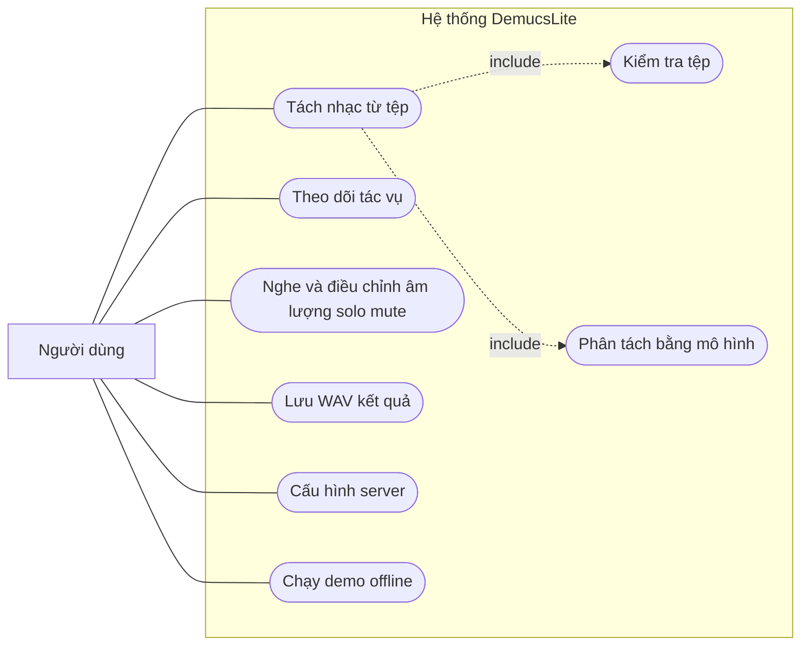
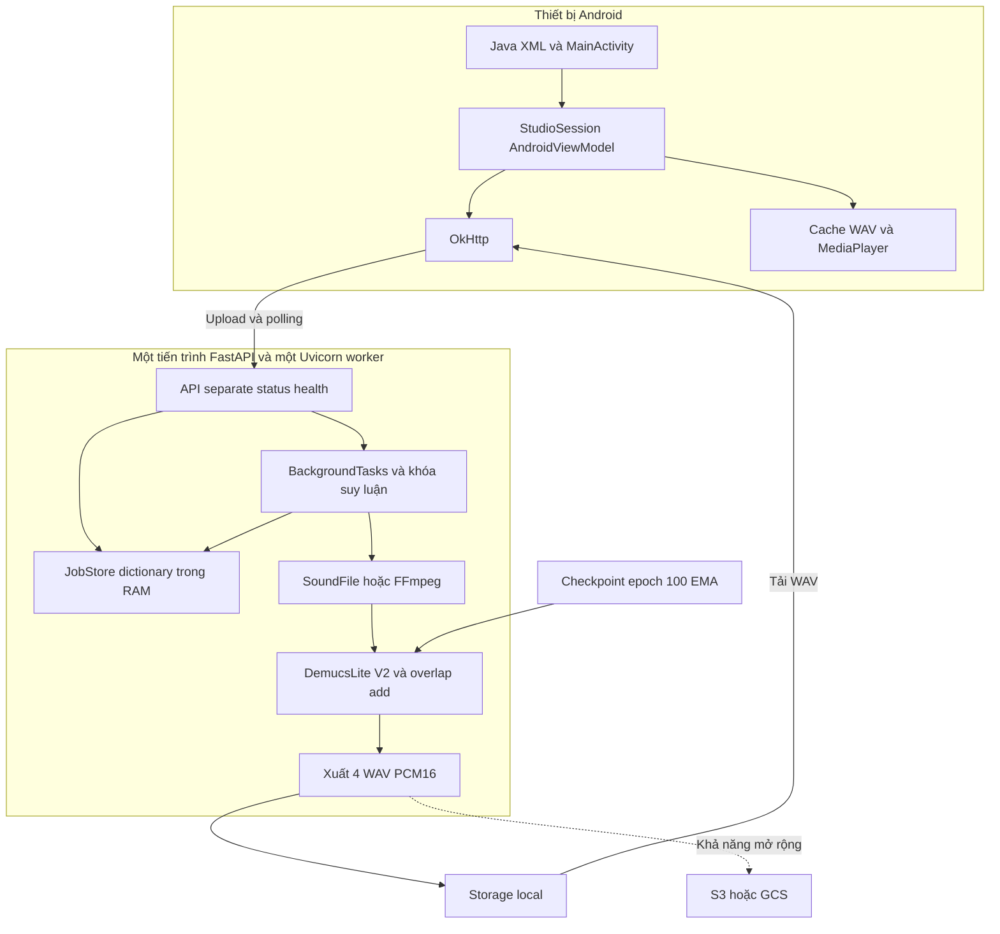
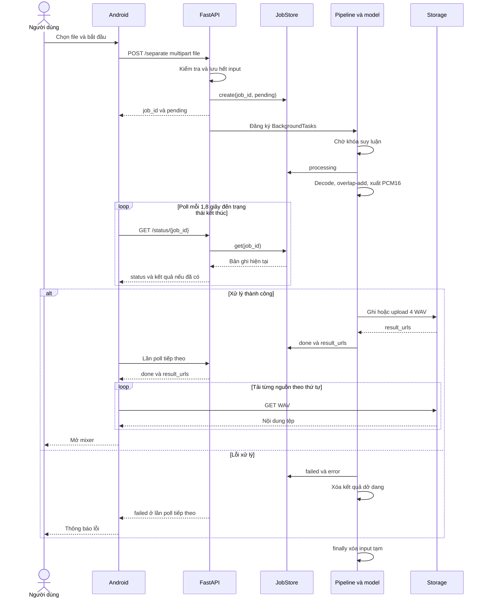
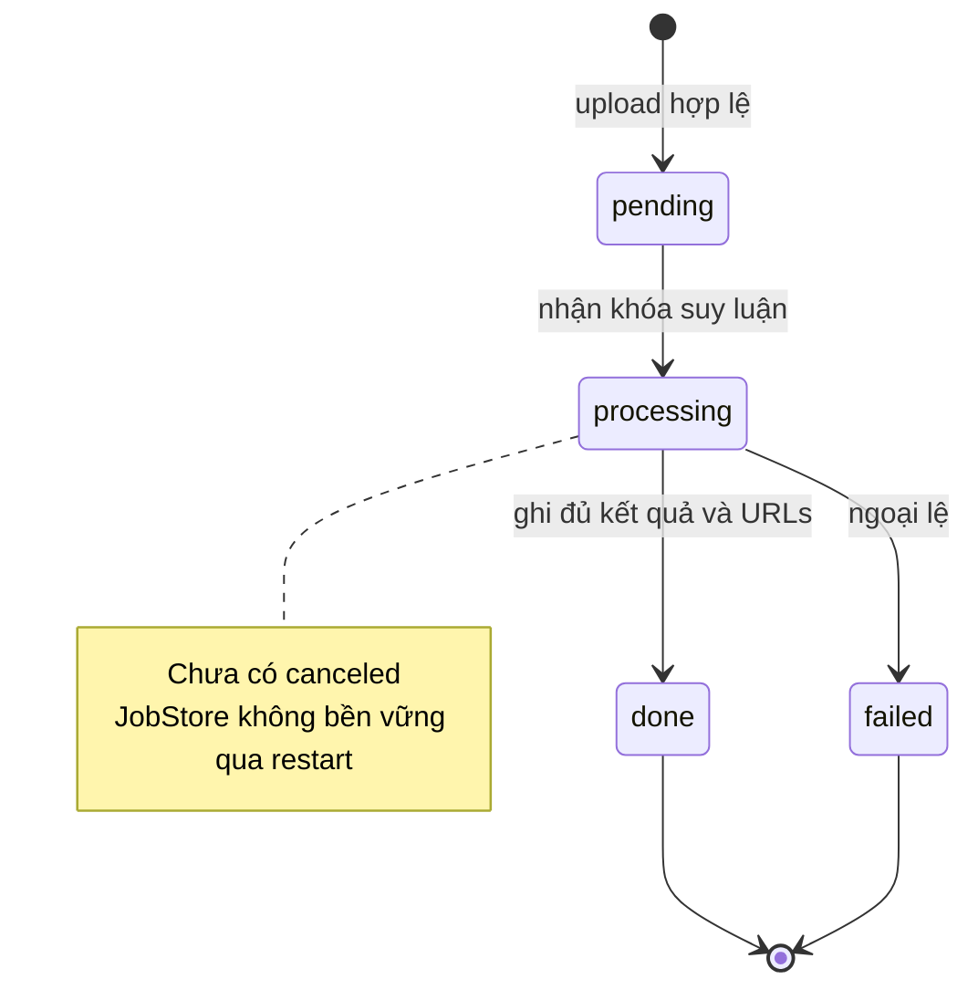
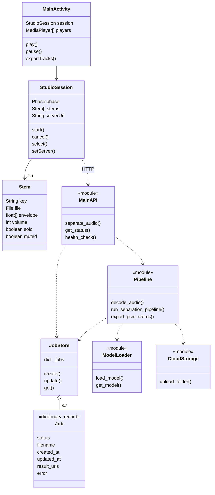
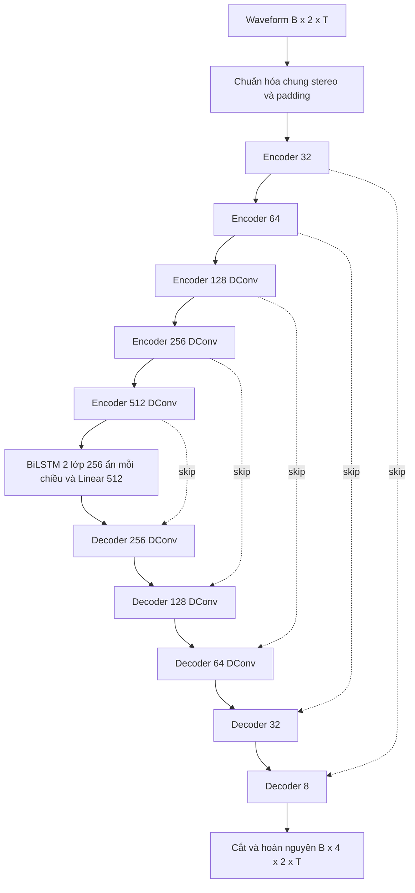
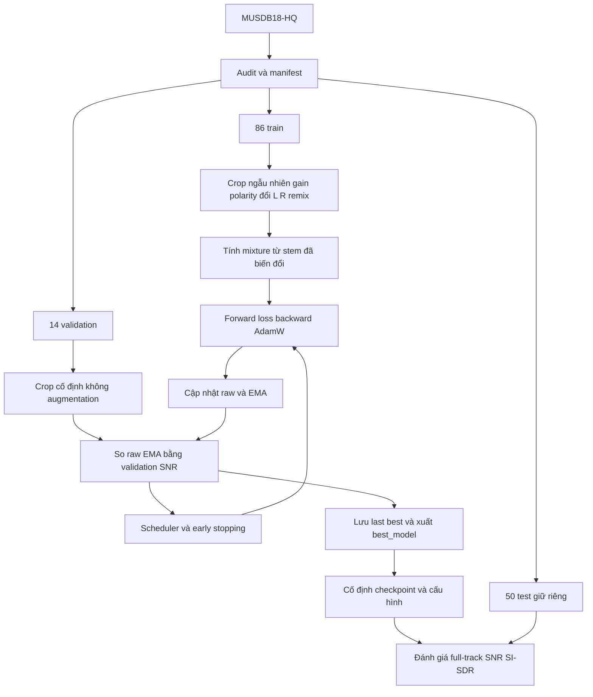

# Sơ đồ hệ thống DemucsLite

Các sơ đồ phản ánh mã nguồn hiện hành ngày 01/11/2026. Hình PNG và SVG dùng trong báo cáo nằm trong `figures/`. Mã Mermaid dưới đây có thể sửa trong Markdown hỗ trợ Mermaid. Riêng use case, Mermaid dùng flowchart mô phỏng ranh giới và ca sử dụng; bản hình trong Word vẽ actor, ellipse và quan hệ include theo cách trình bày UML.

## 1 Use case

Nghe/lưu yêu cầu các stem đã sẵn sàng. Demo tạo âm thanh tổng hợp, không dùng AI. Không có đăng nhập hay dashboard quản trị trong bản hiện hành.

## 2 Kiến trúc triển khai

BackgroundTasks không phải worker độc lập. Nhánh S3/GCS có code, chưa có bằng chứng triển khai thực. File local còn sau restart không có nghĩa JobStore được phục hồi.

## 3 Tuần tự tách nhạc

Vòng polling chạy xen kẽ với pipeline; vị trí khối loop biểu diễn hoạt động đồng thời về mặt logic, không yêu cầu pipeline chờ vòng poll hoàn tất. Hủy phía client không hủy job server.

## 4 Trạng thái job

## 5 Lớp và phụ thuộc module

Job là dictionary, không phải model ORM. MainAPI, Pipeline, ModelLoader và CloudStorage là module Python, không phải các class được khai báo trong source. Stem[] có thể chưa tồn tại trước khi sẵn sàng; khi thành công có bốn phần tử.

## 6 Kiến trúc mạng

Số trong decoder là số kênh đầu ra; skip được cộng trước các phép biến đổi trong decoder. DConv bật ở ba mức sâu. Checkpoint tắt projection mixture_consistency sau forward.

## 7 Dữ liệu và huấn luyện

Sơ đồ mô tả pipeline đã hiện thực. Sự tồn tại của luồng evaluation không chứng minh benchmark V2 đã được chạy đủ 50 bài.
